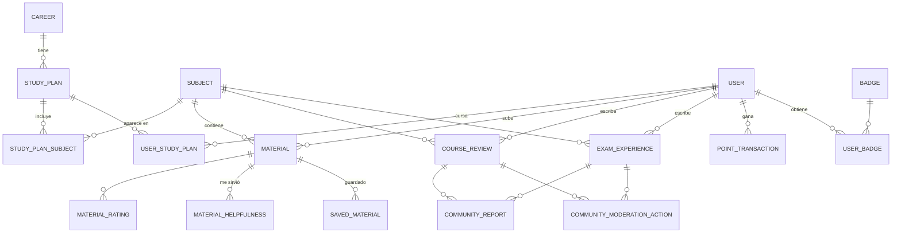

# Base de datos

PostgreSQL con Prisma 7. La fuente de verdad es `apps/backend/prisma/schema.prisma`; este documento explica cómo está organizado y qué falta para lo que ya está especificado. Los nombres del dominio siguen [`CONTEXT.md`](../CONTEXT.md).

No hay Redis: sesiones, tokens y contadores viven en Postgres.

## Mapa del modelo



## Modelos por área

| Área | Modelos | Notas |
|---|---|---|
| Cuentas | `User`, `RefreshToken`, `EmailVerification`, `PasswordResetRequest` | Tokens guardados hasheados. `User` ya tiene `isBanned`, `isMuted`, `mutedUntil`, pero no hay lógica que los use. |
| Instituciones y planes | `University`, `Faculty`, `Career`, `StudyPlan`, `StudyPlanSubject`, `Subject`, `UserStudyPlan` | Universidad → Facultad → Carrera → Plan → Materia ([ADR 0002](adr/0002-jerarquia-universidad-facultad.md)). La materia se vincula al **plan**, no a la carrera, y pertenece a una sola facultad (ver abajo). |
| Recursos | `Material`, `MaterialRating`, `MaterialHelpfulness`, `SavedMaterial` | `Material` guarda el contexto de cursada (`resourceType`, `academicYear`, `professorId`, `shift`), el estado de moderación y los datos del archivo (Drive o staging local). |
| Comunidad | `CourseReview`, `ExamExperience` | Publicación anónima con `isAnonymous`; retiro reversible con `isRemoved`, `removedReason`, `removedAt`, `removedById`. |
| Moderación comunitaria | `CommunityReport`, `CommunityModerationAction` | Un reporte apunta a una reseña **o** a una experiencia. Cada retiro o restauración queda registrado con su motivo. |
| Moderación de materiales | `ModerationLog` (+ enum `ModerationAction`) | Registro de aprobaciones y rechazos. Incluye acciones de ban, mute y guías que nunca se implementaron. |
| Puntos | `PointTransaction`, `User.points`, `User.level`, `User.maxLevel` | Libro de movimientos; `points` es el total acumulado. `maxLevel` es el nivel máximo alcanzado: lo sube el libro y nunca baja (ver abajo). |
| Correcciones | `CorrectionSuggestion` | Una corrección de clasificación sobre un material ajeno: campo, valor actual (para detectar cambios) y propuesto, comentario, estado, quién decidió (autor o moderación) y por qué se cerró. Un índice único parcial permite una sola abierta por material y campo. `Report.priority` marca los reportes prioritarios. |
| Perfil público | `ProfileCustomization` | Una fila por cuenta, creada al guardar por primera vez: avatar, acento, fondo, marco, banner, tema, título, insignias destacadas, aportes fijados (`pinned`, JSON) y «Mostrar mi nivel e insignias». Guarda ids de opciones; lo que deja de valer se ignora al leer. |
| Insignias | `Badge`, `UserBadge` | Tablas creadas, sin datos ni lógica. |
| Heredado | `Professor`, `SubjectProfessor`, `Guide`, `GuideStep` | `Professor` sigue en uso como dato de contexto (quién dictó o tomó). Las guías y las páginas de profesores salieron del producto. |

### Enums relevantes

- `Role`: VISITOR, USER, MODERATOR, ADMIN, SUPERADMIN.
- Contexto de cursada: `Shift`, `CourseCondition`, `CourseAttempt`, `CommunityDifficulty`.
- Finales: `ExamSession`, `ExamFormat`, `ExamOutcome`.
- Recursos: `MaterialResourceType` (PARCIAL, FINAL, APUNTE, RESUMEN, TRABAJO_PRACTICO, GUIA_EJERCICIOS, OTRO) y `MaterialModerationStatus` (PENDING, APPROVED, REJECTED).
- Reportes: `CommunityReportReason` (SPAM_O_REPETIDO, INSULTOS_O_ACOSO, DATOS_PERSONALES, NO_RELACIONADO, POSIBLEMENTE_ENGANOSO, OTRO).

## Preguntas de diseño resueltas

Estas dudas estaban anotadas en el antiguo `README_DATABASE_MODELO.md`.

**¿Por qué la materia se vincula al plan y no a la carrera?** Una misma carrera cambia de plan (Plan 2011, Plan 2023) y la materia puede cambiar de año, de cuatrimestre o desaparecer. `StudyPlanSubject` guarda `year`, `semester` y `credits` para cada plan. Una materia compartida por varias carreras aparece en varios planes sin duplicarse.

**¿Un estudiante puede tener más de una carrera?** Sí. `UserStudyPlan` es la tabla estudiante–plan, con estado ACTIVE, COMPLETED o DROPPED. Reemplazó al `career_id` único del diseño original. Desde el cambio `instituciones`, cada estudiante declara sus planes en *Mi perfil → Mi carrera* (`GET`/`PUT /users/me/study-plans`). Son privados: el perfil público no los muestra.

**¿Cómo se garantiza que una materia pertenezca a una sola facultad?** `Subject.facultyId` es obligatorio y cuatro triggers de la migración `20261011000000_institutions` rechazan con `check_violation` (23514):

- `study_plan_subjects_same_faculty`: vincular un plan con una materia de otra facultad.
- `subjects_faculty_matches_plans`: mover a otra facultad una materia que está en planes.
- `careers_faculty_fixed_with_plans`: mover de facultad una carrera que tiene planes.
- `study_plans_career_same_faculty`: mover un plan con materias a una carrera de otra facultad.

Las relaciones nuevas usan `onDelete: Restrict`: borrar una facultad o universidad con contenido falla. El código de carrera es único por facultad (`@@unique([facultyId, code])`). UNJU y la Facultad de Ingeniería tienen ids fijos (`institutions.constants.ts`) que comparten la migración, el seed y los tests. Las facultades se cargan por migración o seed; no hay alta desde la interfaz.

**Rollback:** Prisma no tiene migraciones hacia atrás. `openspec/changes/archive/*-instituciones/rollback.sql` deshace las dos migraciones (`institutions` e `institutions_trigger_locks`) a mano y borra sus filas de `_prisma_migrations`, porque `migrate resolve --rolled-back` solo acepta migraciones fallidas. Aborta si existe una segunda facultad.

**Concurrencia:** el trigger del vínculo plan–materia bloquea con `FOR SHARE` el plan, la carrera y la materia que lee (migración `institutions_trigger_locks`), así que una mudanza simultánea de cualquiera de ellos espera y después se valida.

**¿Por qué se guarda el nivel máximo alcanzado?** Los desbloqueos de personalización no se pierden si bajan los puntos. `users.max_level` (migración `20261012000000_profile_customization`) arrancó igual a `level`. Desde entonces lo escribe `PointLedger` dentro de la transacción que bloquea la cuenta, solo hacia arriba. `rebuild-points` es el único camino que lo baja: lo deja en el nivel reconstruido. El rollback está en `openspec/changes/archive/*-perfil-publico/rollback.sql`.

**¿Por qué los aportes fijados son JSON y no claves foráneas?** Un aporte retirado o borrado tiene que dejar de mostrarse, y volver si se restaura. Con claves foráneas en cascada se perdería esa vuelta. El perfil público filtra los fijados al leer: propios, publicados, no borrados y con nombre.

**¿Por qué la fase de una corrección no se guarda?** Que una sugerencia pase del autor a moderación a los 7 días, o que quede obsoleta porque su campo cambió, se calcula al leer (`created_at` y `current_value` contra el material). No hace falta ninguna tarea programada, y el estado guardado (`CLOSED`) se actualiza cuando alguien la toca o cuando se edita o retira el material. Las migraciones `20261013000000_trust_privileges` y `20261013010000_role_changed_event` agregan la tabla, `reports.priority`, `CORRECTION_ACCEPTED`, la insignia Lupa y la acción `ROLE_CHANGED` del historial. El rollback está en `openspec/changes/archive/*-privilegios-confianza/rollback.sql`. Aborta si ya hay movimientos `CORRECTION_ACCEPTED` o eventos `ROLE_CHANGED`, porque el historial es append-only.

**Pendiente antes de cargar una segunda facultad:** las URLs de materia son globales (`/materias/:code`, búsqueda por `code` sola). Dos facultades con el mismo código de materia chocarían; hay que decidir el esquema de URLs antes.

**¿Hace falta una tabla para valorar materiales?** Sí, y existe: `MaterialRating` guarda una valoración de 1 a 5 por usuario y material (único por par), con comentario opcional. `Material.avgRating` y `ratingCount` son un caché de esa tabla. El «Me sirvió» es aparte (`MaterialHelpfulness`) y es la señal principal que se muestra.

## Lo que falta para las especificaciones

| Especificación | Cambios en el esquema |
|---|---|
| [Moderación](README_MODERACION.md) y [ADR 0001](adr/0001-publicacion-inmediata-con-moderacion-posterior.md) | Caso de moderación que agrupe reportes de cualquier contenido (materiales, reseñas, experiencias, eventos, avisos); ocultamiento preventivo; sanciones con vencimiento; apelaciones; registro de «Ver autor» con motivo; `Material` publicado por defecto. |
| Alcance por facultad | El modelo `University` → `Faculty` existe desde el cambio `instituciones`. Faltan `ModeratorScope` (moderadores por facultad) y la navegación Universidad → Facultad → Carrera del rediseño: cambio 4 `alcance-por-facultad`. |
| [Puntos e insignias](README_PUNTOS_E_INSIGNIAS.md) | Códigos de motivo nuevos (`MATERIAL_PUBLISHED`, `EVENT_PUBLISHED`, reversiones); catálogo de insignias con clave estable; privilegios por nivel. |
| Formularios de experiencias | Nota de promoción, temas y preparación del final, datos de la mesa; `academicYear`, `attempt` y `outcome` pasan a ser obligatorios según el formulario. |
| Eventos y Clasificados | Modelos nuevos (evento, «Me interesa», organizador verificado; aviso de venta y de tutoría). |

## Migraciones

```
20260718225826_add_auth_fields
20260726022757_remove_forum_setup_app            quita el foro
20260807003124_add_point_transactions
20260812000000_add_reviews_and_moderation
20260828090000_add_material_context_and_interactions
20260828100000_expand_community_evidence
20260828110000_add_community_reporting_and_moderation
```

Flujo de trabajo:

```bash
pnpm --filter backend exec prisma migrate dev --name <cambio>   # crea y aplica
pnpm --filter backend exec prisma generate                      # cliente en src/generated/prisma
pnpm --filter backend exec prisma db seed                       # datos de ejemplo (prisma/seed.ts)
```

- Las migraciones que transforman datos llevan una prueba en `prisma/migration-tests/` (se corren con `pnpm --filter backend test:migration:<nombre>`).
- Los rellenos de datos van en `prisma/backfills/`.
- Nunca editar una migración ya aplicada en otra máquina: crear una nueva.
